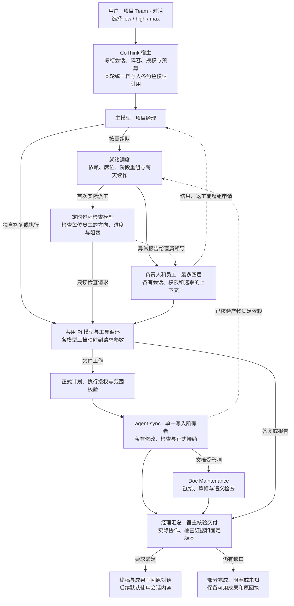

# 统一思考强度三档修订方案

> 2026-11-11 修订，已实施并完成本机安装。基于 `codex/gui-unified-thinking` 的 `3c19388`。本文替代此前“SDK 档位交集”的施工规则。0.8.14-desktop.6 的测试与安装记录保留为旧方案证据。

## 1. 产品定义

所有 GUI 思考选择只提供 `low`、`high`、`max`，默认 `high`。输入区按钮位于发送按钮左侧。用户选一档，本轮主模型、各层员工、过程检查、成果评审和经理汇总均采用这一档；每个模型通过自己的参数映射发送请求。

- 会话选择按现有机制保存。运行中改档作用于下一条新任务。
- 模型参数编辑器同样只有三项，缺省显示并采用 `high`。
- 菜单固定显示三项。型号资料或配置错误由现有模型可用状态说明，修复该型号的登记或映射；它不决定菜单数量。
- “跟随阵容”“思考 默认”“主模型专属档位”退出新 GUI 选择。阵容中的模型参数仍是该模型的配置，本轮会话统一档在提交时覆盖实际角色引用。
- 设置保存、提交冻结、未知结果读取恢复、权限和预算继续使用当前入口。当前方案一的检查员随统一档运行。

### 旧偏好的确定处理

对新任务和当前设置显示，旧值按下表归一；这张表描述升级后的选择规则，不表示原生档位计算量相等。

| 原偏好 | 新三档选择 |
| --- | --- |
| 缺省、空值 | `high` |
| `off`、`minimal`、`low` | `low` |
| `medium`、`high` | `high` |
| `xhigh`、`max` | `max` |

已有主模型专属偏好按上表成为后续新任务的统一档。读取设置只计算有效值，用户再次选择时保存 `{level, scope:"all"}`。历史任务、已经保存的提议和原执行尝试继续使用自己的冻结值与原参数记录。无法识别的损坏值沿已有错误处理，不猜测档位。

## 2. 已核对的模型与实现入口

本次读取了当前配置中七个型号的目录声明，只输出型号、协议和能力字段，并核对固定 SDK 的参数生成代码。当前型号的三档均可使用同名映射，尚无必要增加通用档位换算算法。

| 当前已配置型号/路由 | 本次发现 | 三档服务参数与修改 |
| --- | --- | --- |
| `gpt-6.1-sol`、`gpt-6-astra`，OpenAI Responses | 本地 SDK 已有 low/high/max，另有 medium/xhigh | 使用已有映射，请求 `reasoning.effort` 分别为 low/high/max；GUI 收为三项 |
| `kimi-k3.1-pro`，Moonshot Chat Completions | CoThink 已补充完整三档 | 复用现有 `thinkingLevelMap`，请求 `reasoning_effort` 为同名值 |
| `kimi-k3`，已导入的 Moonshot 官方路由 | 导入模型的 `reasoning:false` 导致仅显示 off | 修正思考能力及兼容字段，同名三档；沿用 reasoning_content 的工具续答处理 |
| `deepseek-flash`，已导入的 DeepSeek 官方路由 | 同样被导入配置登记为 `reasoning:false` | 修正能力及 DeepSeek 格式，发送 `thinking.type="enabled"` 和同名 `reasoning_effort` |
| `deepseek/deepseek-v4.1-flash`、`z-ai/glm-5.3`，OpenRouter | 本地 SDK 已有完整三档映射 | 复用现有适配，请求 `reasoning.effort` 为同名值；off 等原生选项退出 GUI 菜单 |

DeepSeek 官方明确支持 low/high/max，默认 high。Moonshot 的 Kimi K3 官方说明也明确支持这三档。这里采用产品默认 high，并在请求中明确发送，而非依赖各服务商不同的缺省值。[DeepSeek 官方说明](https://api-docs.deepseek.com/guides/thinking_mode/) · [Kimi K3 官方说明](https://github.com/MoonshotAI/Kimi-K3/blob/main/README.md)

### 登记修复的实际接缝

`src/pi-model-runtime.js` 的 `createModelRuntime` 已有刷新与模型补充机制。修复集中在这里，按最终模型的精确型号、协议和实际 baseUrl 匹配官方 endpoint，包括导入后生成的 provider ID。

- Moonshot 匹配 HTTPS `api.moonshot.cn` / `api.moonshot.ai` 的 `/v1`，型号为 kimi-k3 或 kimi-k3.1-pro。
- DeepSeek 匹配 HTTPS `api.deepseek.com` 的根路径或 `/v1`，型号为 deepseek-flash。
- 校正仅覆盖相应思考能力、三档映射和请求兼容字段；endpoint、认证、输出额度、价格和其他型号从当前配置继续取得。OpenRouter 路由采用其已有适配。
- 当前固定 SDK 会把 `models.json` 的模型项覆盖到 NativeProvider 之上，因此单独再加一个 NativeProvider 无法可靠修正导入的 false。使用现有公开 `registerProvider(providerId,{models})`，在读取本轮配置后生成完整的新模型列表，修正匹配项并保留其他模型。避免重复 ID。
- 复用现有 `managedProviders` 和刷新顺序，每次先移除上次的运行时补充，再读取当前配置并应用补充。只传模型定义，不保留含认证状态的旧 provider 对象。SDK 顶层显式 `modelOverrides` 按其现有优先级解释；若它使某型号无法采用三档，具体配置问题进入该型号的可用状态。

已用当前两个导入型号完成内存探针，`registerProvider` 后再刷新，两者均显示支持三档，磁盘模型定义字节一致，未发起模型请求。实施验收还须覆盖 CoThink 自己的刷新包装、重开和移除配置。

补正的两个导入型号设 `reasoning:true`，并设置 `supportsReasoningEffort:true`、`requiresReasoningContentOnAssistantMessages:true`、`supportsDeveloperRole:false`。DeepSeek 的 `thinkingFormat` 为 `deepseek`，Kimi K3 为 `openai`，与已有 SDK 分支及 Kimi K3.1 实现衔接。

对这七个型号使用现有 `thinkingLevelMap` 的 `low:"low", high:"high", max:"max"`。以后接入名称不同的型号，在同一模型定义内明确其三个对应值；资料不足时报告该型号的适配缺口，不生成虚假的三档效果。

## 3. 与原架构的衔接

下图保留原架构的 13 个业务节点和 19 条有向连线，仅在用户选择、宿主冻结和共用 Pi 入口说明三档的流向。

主模型首调、工具后续请求、按需独立成果评审和经理最终汇总都消费冻结的角色引用。图中的共用 Pi 入口代表这套共同调用实现。

灵活性保留在已有 `modelRef.thinkingLevel`。现在由会话选择填入各角色；以后方案二由直属负责人在派工时填入子任务档即可。运行端继续消费角色值，模型定义负责映射。agent-sync 的范围、版本和接纳由其原有接口负责。

## 4. 修改与旧错误清理

### A. 固定三档、修正模型定义

- [x] `src/thinking.js` 复用 `THINKING_LEVELS` 和 high 默认值。新 GUI 写入严格接受三档；增加一个小的旧偏好归一函数，供当前设置投影与新任务准入共同使用。原始历史读取继续保留原值。
- [x] `src/pi-model-runtime.js` 按第二节补正 DeepSeek、Kimi K3，复用 Kimi K3.1 Pro 和其他已支持型号的映射。校验最终 `runtime.getModel` 的三档能力及实际请求字段，覆盖同一 provider 的其他型号仍存在。
- [x] `projectModelFacts` 继续用 SDK 原生能力校验实际型号与参数，其返回值也用于执行准入，不能直接把该字段缩成三档而误拒历史 medium/xhigh。GUI 选项由固定三档列表生成；新的设置写入另用三档严格校验。

### B. 当前设置与新任务采用同一结果

- [x] `src/conversation.js` 的 `resolveConversationThinking` 使用归一后的档位，以 all 范围调用现有 `applyThinkingSelection`；提交锁和快照发布沿用当前实现。
- [x] `src/gui-controller.js` 的当前会话投影采用同一归一结果，返回有效三档及 all 范围。历史任务详情读取已保存的原值，避免显示值与新请求值不一致。
- [x] `saveConversationThinking` 对新写入保存明确三档与 all 范围。缺省采用 high，删除“清除即跟随阵容”的现行行为。原提议确认、原尝试恢复继续走已保存的配置；明确新一轮续作采用当前归一结果。
- [x] `saveGuiTeam` 与 GUI 参数编辑采用同一旧值归一表，保存时写明确三档；已有阵容在单纯读取时不回写文件。
- [x] GUI 输入协议由 4 升为 5，复用现有版本门槛，避免缓存的 .6 页面继续发送“跟随阵容”或额外档位。历史与已接收提交的回执仍可查询。草稿格式和任务格式沿用当前结构。

### C. 收敛所有 GUI 入口

| 位置 | 必须清理的旧规则 | 修订后 |
| --- | --- | --- |
| `gui/src/view.js` 的 `conversationThinking` | SDK 档位求交集、空交集解释 | 三项固定选项与服务端有效选择；型号错误使用现有可用状态 |
| `gui/src/Composer.js` | 跟随阵容按钮、默认档标签、主模型专属标签和说明 | 按钮显示“思考 low/high/max”，菜单恰好三个选择 |
| `features/teams/ModelEditor.jsx` | 默认 high/off 的第四项、原生全部档位、旧值追加选项 | 恰好三项，按归一表显示旧偏好，新保存使用明确值 |
| `features/teams/TeamPanel.jsx` | 跟随阵容提示、仅主模型实际档位摘要 | 说明本轮统一档及每个模型三档配置 |
| `gui/src/useEditorPersistence.js` | 缺值等同于清除覆盖的提交含义 | 新设置始终传明确档位；复用已有排队、保存和未知回执恢复 |

- [x] 三档列表及编辑器的旧值显示归一放在现有 `gui/src/view.js`，供菜单和 ModelEditor 共用；后端在现有 `thinking.js` 复用常量与归一函数。允许这组很小的规则在前后端各一份，用同一组输入输出断言保持一致，避免 GUI 引入后端的 Node/SDK 依赖。无需新建模块。
- [x] 原 .6 的待确认选档如果含空值或额外档位，按既有“读取并采用当前已保存设置”处理，不重发旧修改。归一后的当前值仍只有三档，草稿保留。
- [x] 恢复数据、重复点击保护、设置与草稿共用队列、按钮布局、已有 CSS 与保存 helper 直接复用。删除确实失去调用方的旧显示分支和专用样式，不扩大清理范围。

### D. 改正验收与文档

- [x] 将 `test/gui-components-thinking.test.js` 中“交集只有 low/high”和“只剩跟随阵容”的成功预期改为恰好三项。更新 `test/gui-thinking-visual.test.js`、`test/helpers/desktop-thinking.js`，实际选择三档逐次读取保存值。
- [x] 更新 `test/gui-context.test.js` 等现有用例中“当前投影仍为 main”“清除后跟随阵容”的预期，验证新 GUI 投影为归一三档/all；原始历史 metadata 和旧任务参数仍按保存值断言。
- [x] 新增断言落在现有模型/运行时测试入口，覆盖导入的 false、当前七个型号、实际服务格式和跨角色传递。保留有用的队列与恢复回归，旧历史专用断言按历史含义保留。
- [x] README、设计基线和当前更新记录使用三档定义。0.8.14-desktop.6 的请求、测试、失败和安装记录保留，并明确它未达到本次三档标准。此前“严格交集方案通过验收”的结论退出当前验收口径。

## 5. 按顺序验收

1. **先验当前模型定义。** 复制当前配置的型号、endpoint 和非敏感能力字段到隔离夹具，凭据用本地假值。七个型号均得到三档；尤其验证两个导入的 false 在刷新后被正确补正。配置文件字节、认证归属和同 provider 其他模型正确保留。
2. **再验实际参数。** 对每个型号的 low/high/max 捕获 SDK 生成的请求正文，按第二节对应字段核对。DeepSeek 同时验证 thinking enabled、reasoning_effort 和带工具时 reasoning_content 续传。不能仅断言 GUI 标签或任务记录。
3. **再验整轮传播。** 用“廉价team”“中等team”同构的隔离阵容分别选择三档。现有组队夹具覆盖主模型、员工、过程检查、成果审查和汇总；每个实际产生角色的请求都与选择对应。
4. **最后验 GUI 与安装包。** 空新对话、已有对话、模型编辑器均恰好三项，默认 high。复用快速选档后发送、重复恢复、重开和提议确认的用例。安装后的正常用户界面必须能在当前阵容中选三档，打开和选档本身零模型请求。

按改动运行已有 `gui-components-thinking`、`gui-thinking-visual`、`gui-context`、`pi-runtime`、`pi-kimi` 及原生/组队相关测试；完整 GUI、Pi 和打包 App 验收沿用仓库脚本。对已修正的 SDK 声明和官网参数，以上验证证明本地选档与请求构造；远端真实接受和质量另按明确收费授权验证。

实施后的候选使用下一补丁版本 `0.8.14-desktop.7`，按原 `.noindex` 构建、资源核验、数据备份和唯一正式安装流程交付。三个核心验收项为“菜单只有三档、逐模型参数正确、实际角色请求匹配”。

## 6. 本次方案复核及已消除的缺口

| 检查项 | 初次核对发现的缺口 | 方案中的修正 |
| --- | --- | --- |
| 架构准确 | 容易把 GUI 选项当作服务端统一原生能力 | 产品三档与每模型参数在现有 modelRef / Pi 映射处分工；原 13 节点、19 连线保留 |
| 架构灵活 | 在传输层强塞一个全局参数会妨碍后续分档 | 统一值只在本轮角色配置形成时应用，后续仍可逐岗位赋值 |
| 复杂性 | 交集、默认、历史主模型标签形成多套当前选择 | 三项和一个 high 默认值；旧值通过小表归一，使用既有存储与恢复 |
| 模型登记 | 只补 DeepSeek 会遗漏现有 kimi-k3；NativeProvider 又会被导入 false 覆盖 | 已核对全部七型号，内存验证 registerProvider 的有效覆盖顺序 |
| 清理完整 | 模型编辑器、Team 摘要、旧测试和计划仍保留错误规则 | 第四节逐入口列出删除与替换，运行旧值只保留历史用途 |
| 默认与升级 | 仅改菜单会让按钮 high、实际仍走旧默认或主模型专属值 | 当前设置投影与新提交使用同一归一规则，协议门槛阻止旧界面写入 |
| 验收一致 | .6 的大量通过项未检验用户真正要求 | 以当前阵容的三档操作和实际请求作为交付门槛，旧成绩只作历史证据 |

第二轮对照调用方又修正了一处缺口：`projectModelFacts` 同时服务 GUI 和执行准入，故保留其原生能力校验，GUI 单独固定三项，避免误拒旧任务的合法原生参数。

上述两轮复核在施工前只验证了源码接缝、目录事实、官方参数说明、运行时覆盖机制的内存探针及文档结构。现已按本文完成源码实现；新的代码与安装验收分别记录于 VALIDATION.md 和本机 work/unified-thinking-three-levels/，不以方案复核代替执行证据。
